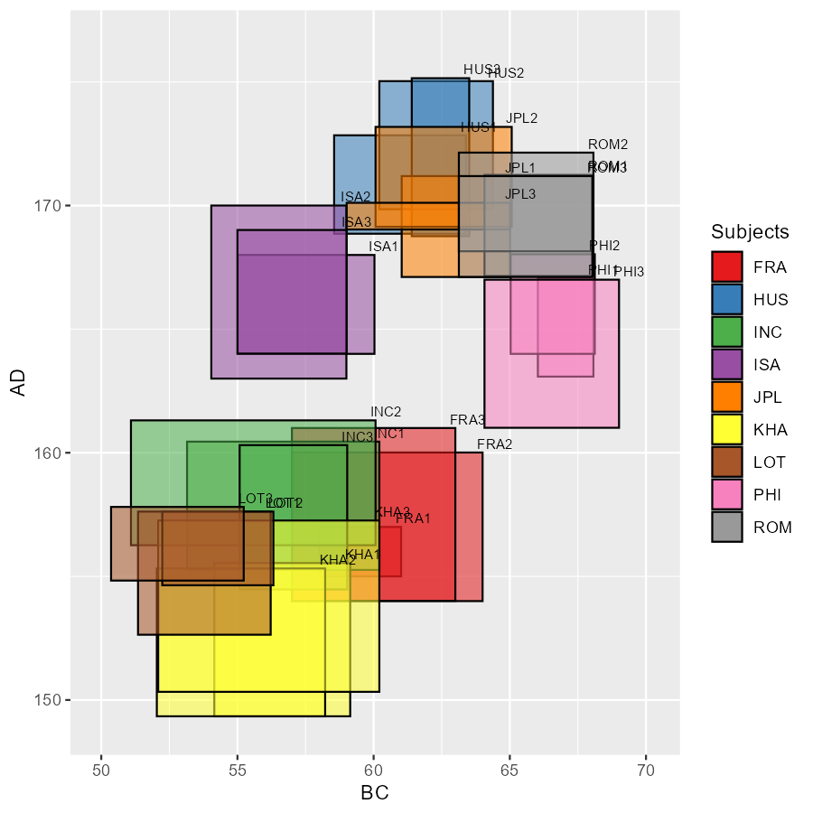
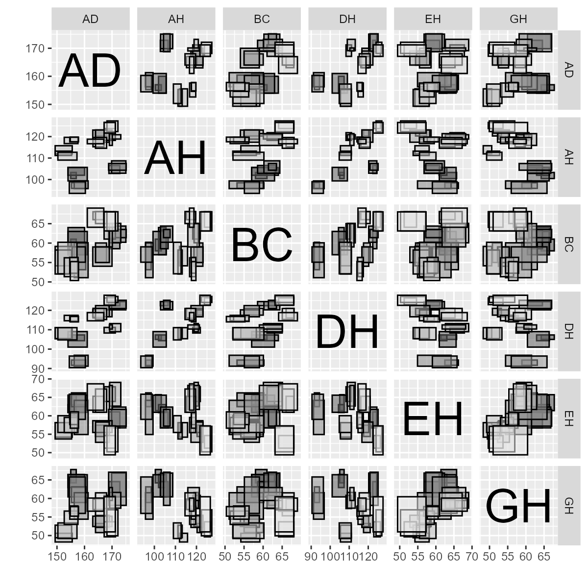
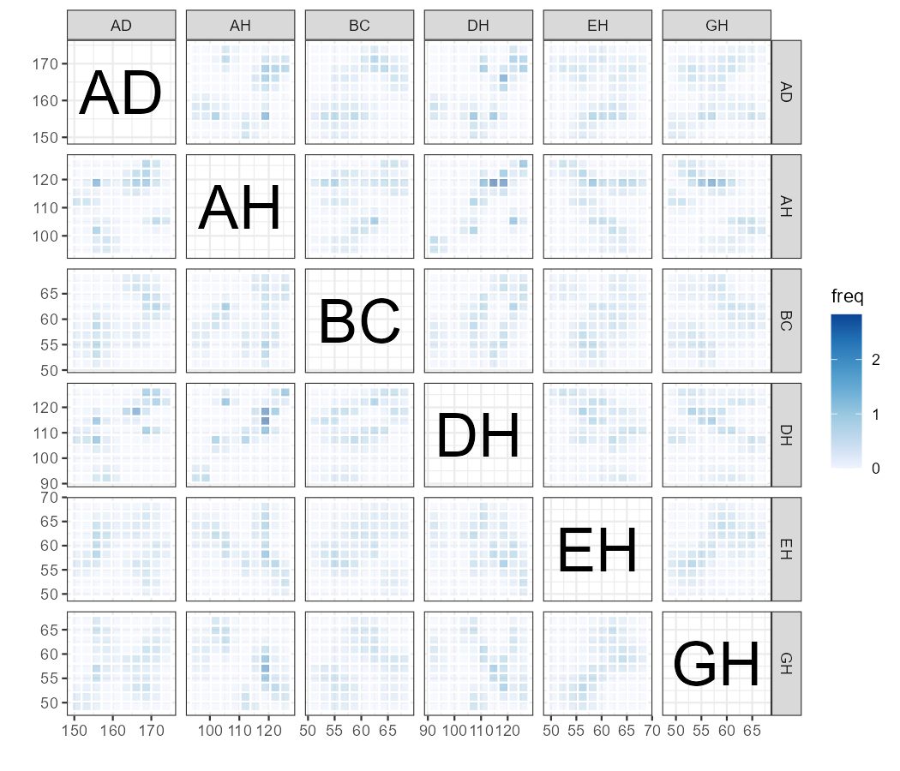
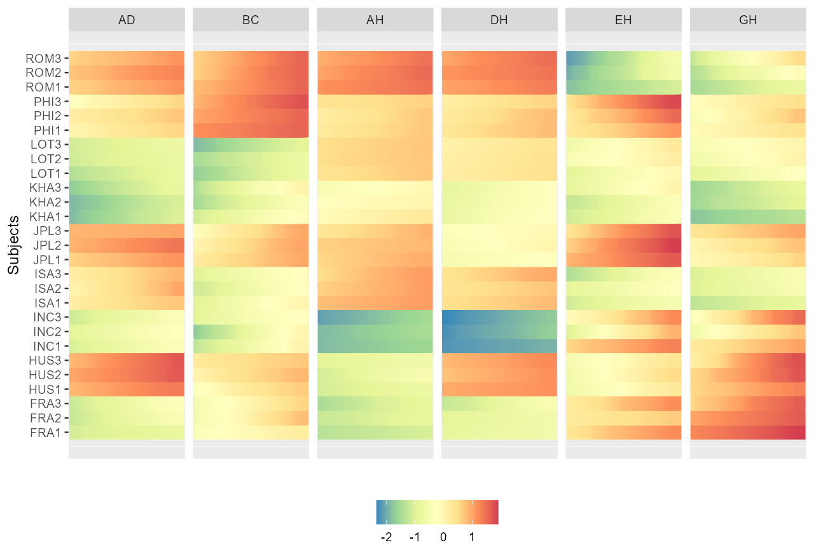
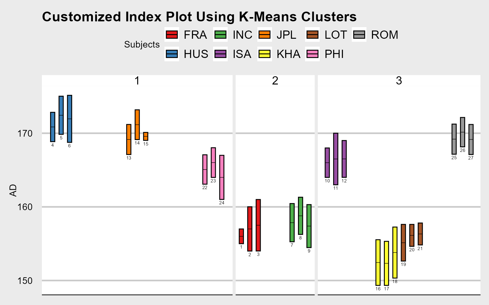
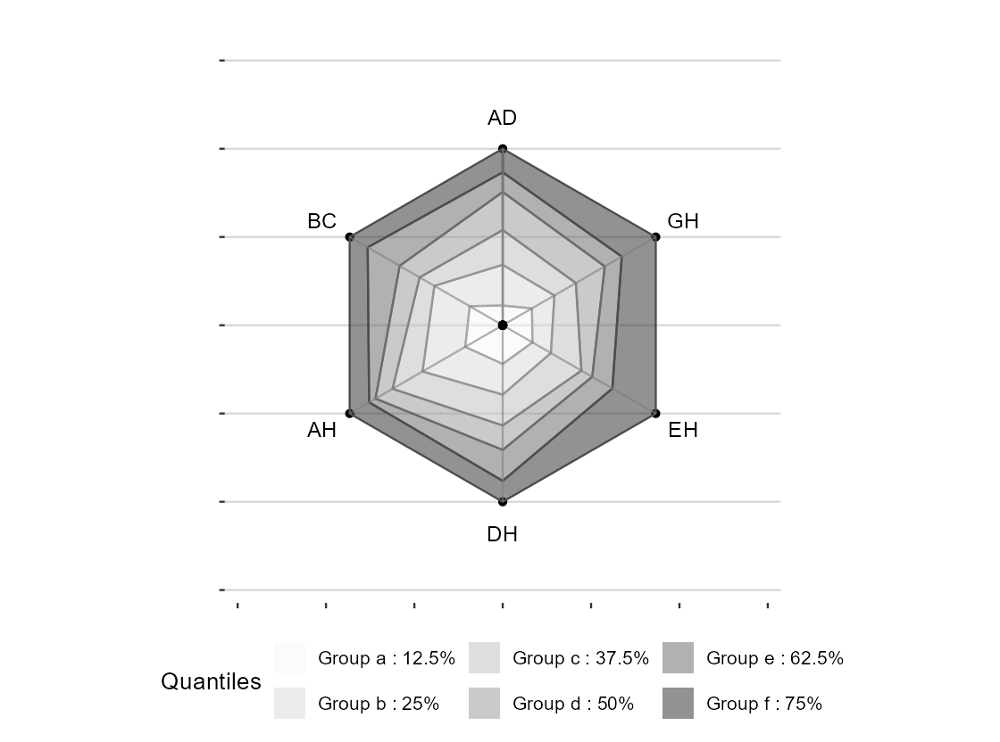
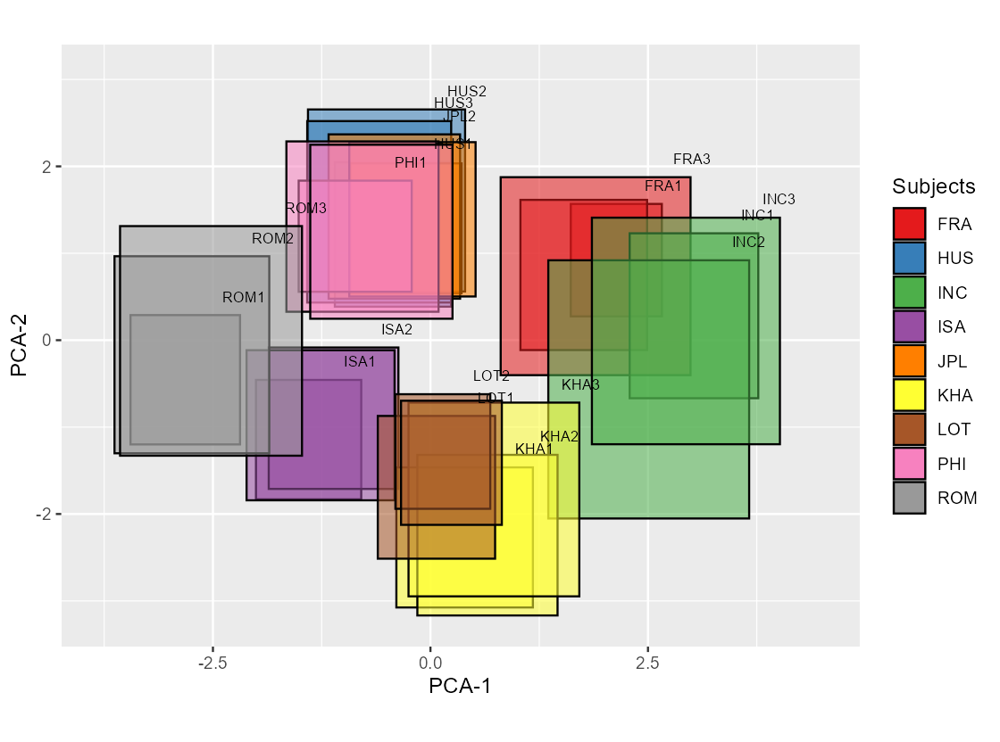
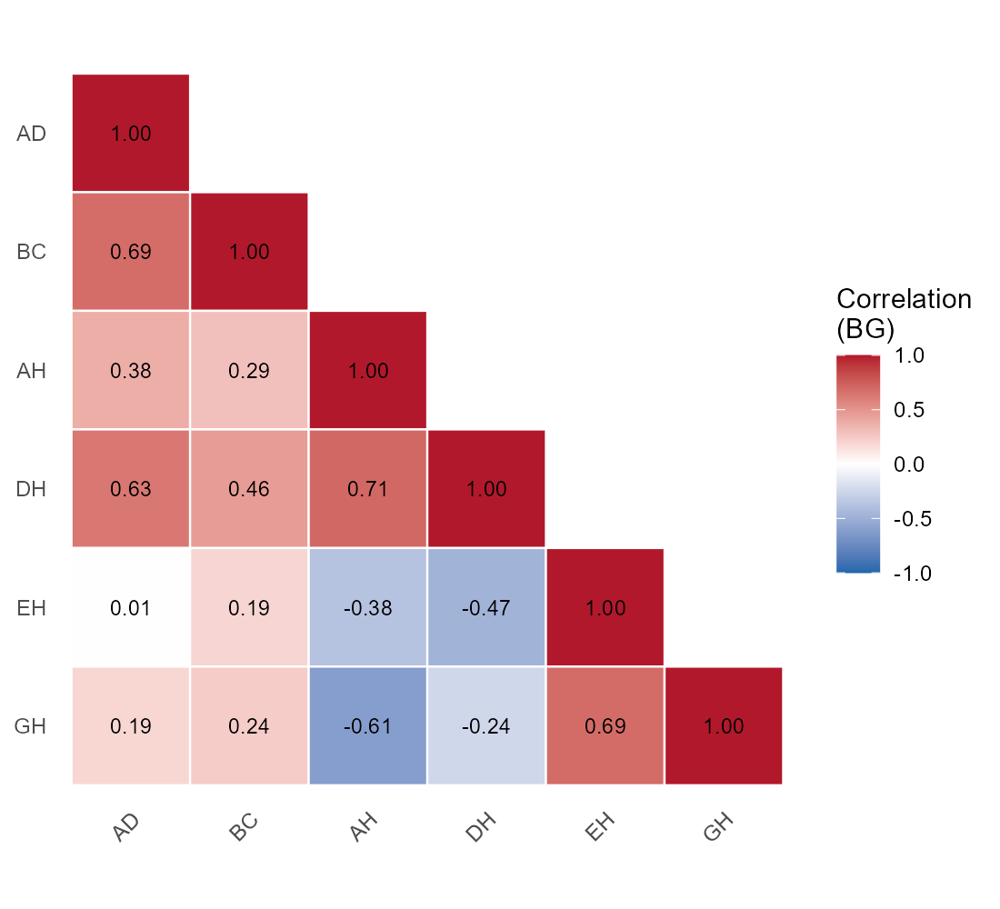
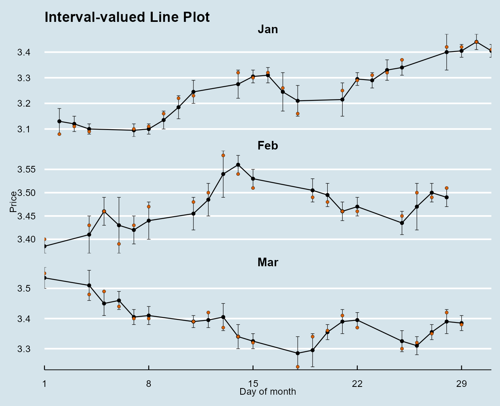

# ggInterval

[](https://CRAN.R-project.org/package=ggInterval)
[](https://github.com/hanmingwu1103/ggInterval/releases)
[](https://www.gnu.org/licenses/old-licenses/gpl-2.0.en.html)

**ggInterval** extends `ggplot2` for interval-valued data. It provides
plotting functions, data conversion helpers, and examples for symbolic data
analysis workflows where each unit is described by lower and upper bounds
rather than a single point.

The package was previously released as **ggESDA**. The current development line
focuses on interval-valued visualization and companion tools for building
interval data from classical tables.

## Highlights in 0.2.6

The features in this section are not supplied by the 0.2.5 release.

- Adds `ggInterval_ecdf()`, `ggInterval_CRcor()`,
  `ggInterval_deviation()` and `ggInterval_overlap()` for endpoint ECDF
  envelopes, center--range associations, endpoint-deviation contributions,
  and geometric box overlap. These return ordinary ggplot objects with an
  `interval_diagnostics` attribute and provide descriptive graphics, not
  confidence bands, outlier tests or new symbolic correlation estimators.

- Adds `stock.data.LH`, a directly inspectable symbolic table for the financial
  line-plot example. Its 62 observations come from the randomly generated
  `TTR::ttrc` series and do not represent an actual security.
- Fixes point-interval and constant-variable handling in `ggInterval_hist()`,
  `ggInterval_2Dhist()` and `ggInterval_2DhistMatrix()`. In the mass-based
  modes (1D equal-bin and both 2D methods) a point interval now contributes
  unit mass to exactly one bin (left-closed, right-open bins with the final
  endpoint included), constant variables get a padded support, and bin counts
  are validated; positive-width overlap weighting in these modes is unchanged.
- In the 1D `unequal-bin` coverage-count display (not a probability mass) a
  constant variable is shown as its coverage count at the exact value, and the
  encoding of the first coverage run is corrected. Compatibility note: when
  several intervals share the minimum, the first rectangle now starts at the
  minimum with the true count; for `facedata` AD the first unequal-bin table
  row therefore changes from `[149.35:150.32] 1` (0.2.5) to
  `[149.34:150.32] 2`.
- Documents the histogram construction, actual return values of the histogram
  and PCA functions, class-specific `scale()` behaviour, and the verified
  provenance of the `Environment` data. The introductory vignette includes
  the four diagnostics on the manuscript's seeded simulation, the built-in
  financial data, and the assumptions and interpretation limits of the
  displays. See `NEWS.md`.
- Corrects the `INCOMELEVEL` category labels of `Environment` to the SODAS
  source order (25, 75, 50, 90, 100); the proportions are unchanged.
- `ggInterval_PCA(poly = TRUE)` builds its edge table in one step (identical
  results, much faster) and reports clearly when zero-width intervals or
  shared vertices leave an observation without all of its vertices.

## Highlights in 0.2.5

- Adds interval-valued correlation heatmaps through `ggInterval_corrplot()`.
- Adds `ggInterval_lineplot()` for interval time-series style displays, with
  `ggInterval_tsplot()` retained as a backward-compatible alias.
- Updates histogram, 2D histogram, scatter, radar, PCA, and index-image
  examples and smoke tests.
- Standardizes package citation metadata and dataset/reference documentation.
- Includes tests for symbolic covariance and correlation method mappings.

## Installation

Install the CRAN release:

```r
install.packages("ggInterval")
```

Install the latest GitHub release:

```r
# install.packages("remotes")
remotes::install_github("hanmingwu1103/ggInterval@v0.2.6")
```

Install the current development version:

```r
# install.packages("remotes")
remotes::install_github("hanmingwu1103/ggInterval")
```

## Quick Start

```r
library(ggInterval)

# Load the built-in interval-valued face measurements
data(facedata)

# Scatter plot
ggInterval_scatterplot(facedata, aes(x = AD, y = BC))

# Histogram
ggInterval_hist(facedata, aes(x = AD), method = "equal-bin", bins = 10)

# 2D histogram with non-equidistant bins
ggInterval_2Dhist(
  facedata,
  aes(x = AD, y = BC),
  method = "unequal-bin"
)$plot

# Correlation heatmap
ggInterval_corrplot(facedata, method = "BG", triangle = "lower")
```

Version 0.2.6 also supplies a synthetic financial example and
four diagnostics:

```r
data("stock.data.LH")
head(stock.data.LH)
ggInterval_lineplot(stock.data.LH, aes(x = Day, y = V1)) +
  facet_wrap(~Month, ncol = 1, scales = "free_y")

ggInterval_ecdf(facedata, variables = "AD")
ggInterval_CRcor(facedata, variables = c("AD", "BC"))
ggInterval_deviation(facedata, variables = c("AD", "BC"))
ggInterval_overlap(facedata, variables = c("AD", "BC"))
```

`stock.data.LH` has 62 synthetic daily low--high observations from
`TTR::ttrc`, not an actual security. TTR is needed only to reconstruct this
stored subset, not to load it. The vignette explains the columns and
complete construction.

Most graphics return ordinary ggplot objects. For histograms and 2D
histograms add layers to `$plot`; for `ggInterval_PCA()` use `$ggplotPCA`
from the returned augmented `princomp` object. For a diagnostic plot `p`,
`attr(p, "interval_diagnostics")` exposes its computed values.

## Main Functions

### Visualization

| Function | Description |
| --- | --- |
| `ggInterval_scatterplot()` | Scatter plot for two interval-valued variables |
| `ggInterval_scatterMatrix()` | Scatter plot matrix for interval-valued variables |
| `ggInterval_3Dscatterplot()` | Two-dimensional display of three-variable interval boxes |
| `ggInterval_hist()` | Equal-bin mass allocation or unequal-bin coverage counts |
| `ggInterval_2Dhist()` | 2D histogram with equal-bin or unequal-bin construction |
| `ggInterval_2DhistMatrix()` | Matrix of 2D histograms |
| `ggInterval_MMplot()` | Min-max plot |
| `ggInterval_CRplot()` | Center-range plot |
| `ggInterval_indexplot()` | Index plot |
| `ggInterval_indexImage()` | Index image plot |
| `ggInterval_boxplot()` | Boxplot for interval-valued variables |
| `ggInterval_radarplot()` | Radar plot |
| `ggInterval_lineplot()` | Line plot for interval-valued data |
| `ggInterval_PCA()` | PCA display for interval-valued data |
| `ggInterval_corrplot()` | Correlation heatmap for interval-valued variables |
| `ggInterval_ecdf()` | Endpoint ECDF bounds, with an optional midpoint curve |
| `ggInterval_CRcor()` | Pearson associations of centers and full ranges |
| `ggInterval_deviation()` | Center and range contributions to endpoint deviation |
| `ggInterval_overlap()` | Pairwise intersection-over-union of interval boxes |

### Data Conversion

| Function | Description |
| --- | --- |
| `classic2sym()` | Convert classical data to interval-valued data |
| `RSDA2sym()` | Convert RSDA symbolic objects to `ggInterval` format |

## Example Graphics

Representative figures generated from `LaTeX/S2_File_ggInterval_examples.R`.

<table>
  <tr>
    <td align="center" width="50%">
      <strong>Interval Scatter Plot</strong><br>
      <sub><code>ggInterval_scatterplot()</code></sub><br>
      
    </td>
    <td align="center" width="50%">
      <strong>Scatter Matrix</strong><br>
      <sub><code>ggInterval_scatterMatrix()</code></sub><br>
      
    </td>
  </tr>
  <tr>
    <td align="center" width="50%">
      <strong>2D Histogram Matrix</strong><br>
      <sub><code>ggInterval_2DhistMatrix()</code></sub><br>
      
    </td>
    <td align="center" width="50%">
      <strong>Index Image</strong><br>
      <sub><code>ggInterval_indexImage()</code></sub><br>
      
    </td>
  </tr>
  <tr>
    <td align="center" width="50%">
      <strong>Customized Index Plot</strong><br>
      <sub><code>ggInterval_indexplot()</code> with k-means groups</sub><br>
      
    </td>
    <td align="center" width="50%">
      <strong>Radar Plot</strong><br>
      <sub><code>ggInterval_radarplot()</code></sub><br>
      
    </td>
  </tr>
  <tr>
    <td align="center" width="50%">
      <strong>PCA Display</strong><br>
      <sub><code>ggInterval_PCA()</code> / PCA score intervals</sub><br>
      
    </td>
    <td align="center" width="50%">
      <strong>Correlation Heatmap</strong><br>
      <sub><code>ggInterval_corrplot()</code></sub><br>
      
    </td>
  </tr>
  <tr>
    <td align="center" colspan="2">
      <strong>Interval-Valued Line Plot</strong><br>
      <sub><code>ggInterval_lineplot()</code></sub><br>
      
    </td>
  </tr>
</table>

## Documentation

- Installed introduction: `vignette("ggInterval_Intro", package = "ggInterval")`
- CRAN: <https://CRAN.R-project.org/package=ggInterval>
- GitHub releases: <https://github.com/hanmingwu1103/ggInterval/releases>
- Issues: <https://github.com/hanmingwu1103/ggInterval/issues>

## Citation

Use the installed package citation metadata:

```r
citation("ggInterval")
```

The package citation is shipped with `inst/CITATION` and points to the
canonical CRAN package URL and DOI.

## License

GPL (>= 2)
